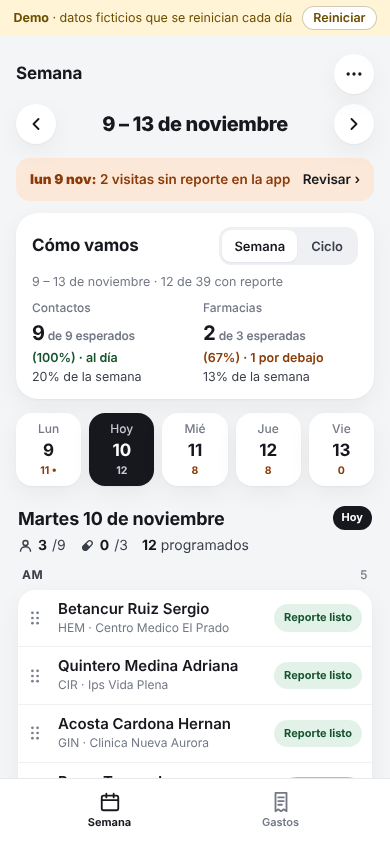
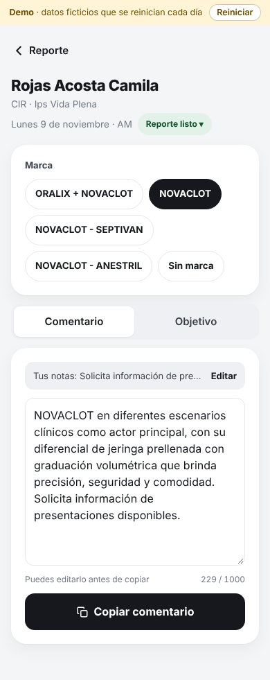
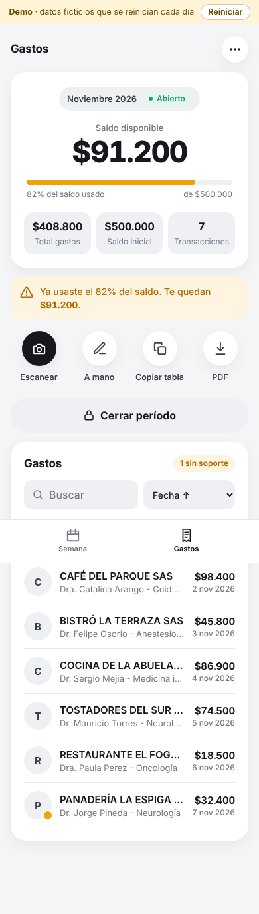

# Visita médica · asistente para una visitadora médica

**[Español](#español) · [English](#english)**

> Versión de portafolio de una app que está en uso real. Los datos, el laboratorio, las marcas y las personas son ficticios.
> Demo en vivo: **https://visita-medica-demo.pages.dev** · PIN **1234** (se reinicia cada día).
> Documento de producto completo (PRD): **[docs/PRD.md](docs/PRD.md)** — problema, métricas, reglas, decisiones, IA (modelos, guardrails, evals), arquitectura, seguridad y modelo de datos.

<p align="center">
  
  
  
</p>

---

## Español

### El problema
Una visitadora médica de un laboratorio farmacéutico visita entre 9 contactos y 3 farmacias por día hábil. Además de las visitas, cada día tenía que:

- **Escribir el reporte de cada visita** en la tablet del laboratorio (comentario y objetivo, con el mensaje de la marca que presentó). Le tomaba **unas 2 horas diarias**.
- **Armar la planeación de la semana** (a quién visita, cuándo y dónde, cumpliendo la frecuencia de cada médico en el ciclo). Le tomaba **unas 3 horas** por semana.
- **Legalizar los gastos** de una tarjeta precargada (cafés y almuerzos con médicos): pasar cada factura a una hoja de Excel y juntar los soportes en un PDF. Lo hacía a mano, con errores, y se pasaba del cupo porque no veía cuánto llevaba.

### Resultado
| Tarea | Antes | Con la app |
|---|---|---|
| Reportes de visitas | ~2 horas al día | **~20 minutos al día** |
| Planeación semanal de visitas | ~3 horas a la semana | **~30 minutos a la semana** |
| Gastos | A mano, con descuadres y sin ver el saldo | Saldo siempre visible, factura leída por IA, tabla lista para pegar en Excel |

La usuaria la usa a diario desde octubre de 2026. Se lanzó por fases: gastos (oct-2026), planeación y seguimiento de visitas (28-oct) y reporte con dictado (2-nov).

### Qué hace
**Visitas**
- **Semana**: las visitas de cada día en AM/PM, con estados que se cambian con un toque (por hacer, realizada, no efectiva, reporte listo) y aviso de días anteriores sin reporte.
- **Cómo vamos**: contactos y farmacias con reporte frente a la meta del ciclo (20 días hábiles, sin festivos de Colombia) y frente a lo esperado a la fecha.
- **Planear un día**: por ciudad e institución, solo muestra a quién le falta visita en el ciclo; AM o PM con un toque.
- **Reporte**: la usuaria elige la marca, dicta o escribe su nota, la IA la limpia (ortografía, sin muletillas) y la app arma *mensaje de la marca + su nota*, listo para copiar en la tablet.

**Gastos**
- **Escanear la factura**: foto o PDF → la IA llena proveedor, NIT, número, fecha y valor; ella revisa antes de guardar.
- **Saldo del período siempre visible**, con aviso amarillo desde el 80% y rojo al pasarse.
- **Copiar tabla**: 16 columnas que caen exactas en la hoja de legalización (que tiene celdas combinadas).
- **PDF de soportes**: un solo archivo, en el orden de la tabla.

### Decisiones de producto
- **Una app web, no nativa.** Funciona en el iPhone y en el computador desde un enlace; nada que instalar ni aprobar en tiendas.
- **La IA solo donde ahorra tiempo y siempre con revisión humana.** Lee facturas y limpia el dictado; ella confirma antes de guardar o copiar. El mensaje de cada marca **nunca pasa por la IA**: es texto fijo aprobado, para no arriesgar lo que se le dice al médico.
- **Avisar en vez de bloquear.** El saldo puede quedar negativo (lo que cuenta es lo que ya salió de la tarjeta) y el soporte es opcional al guardar, pero la app avisa antes de cerrar el período. Lo único que se bloquea es una factura repetida (mismo NIT + mismo número).
- **"Esperado" se calcula hasta ayer.** Comparar contra el día que aún no termina hacía que siempre pareciera atrasada a media mañana.
- **Encajar en lo que ya existe.** La tabla se copia con columnas vacías donde el Excel tiene celdas combinadas y el reporte se copia al formato de la tablet: la app no pide cambiar los procesos del laboratorio.
- **Fuera de alcance (a propósito):** app nativa, lectura de QR, conciliación bancaria, impuestos de retiro, varias usuarias.
- **Costo casi cero.** Plan gratis de Cloudflare y un modelo de IA pequeño (USD 1–2 al mes). Las limitaciones del plan gratis moldearon el diseño: el PDF se arma en el navegador y la limpieza de archivos corre al abrir la app.

### Cómo se construyó
- **Producto: Juan Carlos Franco Zafra** — entrevistas con la usuaria, definición de reglas, priorización por fases, pruebas en su iPhone y aprobación de cada cambio.
- **Código: [Claude Code](https://claude.com/claude-code)** — escribió el código a partir de esas definiciones, con pruebas automatizadas en cada cambio.
- Ciclo de trabajo: ramas con versión de prueba propia (base de datos separada), la usuaria prueba, se ajusta y se lanza. Más de 100 pruebas automatizadas de la API.

### Stack
Cloudflare Pages (HTML, CSS y JavaScript sin framework) · Pages Functions (API) · D1 (SQLite) · R2 (archivos) · API de Claude con visión (facturas y ajuste de texto) · Whisper en Workers AI (dictado) · pdf-lib (PDF en el navegador).

```
Navegador ──► Cloudflare Pages (public/)
          └─► Pages Functions /api ──► D1 (datos) · R2 (soportes)
                                  └──► Claude (facturas, texto) · Whisper (dictado)
```

### Sobre esta demo
- **Datos ficticios** (laboratorio "Nexalia", marcas, médicos, farmacias, proveedores y NIT inventados). Se reinician solos cada día y con el botón **Reiniciar**.
- **IA simulada**: la lectura de facturas devuelve una factura de ejemplo, el dictado una nota de ejemplo y el ajuste del texto se hace con reglas locales. Así la demo no tiene costo ni usa llaves. Con `DEMO_MODE = "0"` se usa la IA real.
- Archivos de máximo 3 MB; se borran al reiniciar.
- La versión en uso real es privada; esta comparte el mismo código, solo cambian los datos y el modo demo (`lib/demo.js`).

### Más detalle
El [PRD](docs/PRD.md) explica requisitos, reglas de negocio, decisiones, el uso de IA (modelos, guardrails y evals), infraestructura, seguridad y modelo de datos.

### Correr en local
```bash
npm install
cp .dev.vars.ejemplo .dev.vars
npm run dev:demo          # demo con datos de ejemplo en http://localhost:8789 (PIN 1234)
npm run dev               # base vacía en http://localhost:8788
BASE=http://localhost:8788 npm test        # pruebas de la API (base vacía)
BASE=http://localhost:8789 npm run test:demo  # pruebas del modo demo
```
Publicarla en Cloudflare: ver [docs/PUBLICAR.md](docs/PUBLICAR.md).

### Estructura
- `public/` — la app (`app.js` gastos y navegación, `visitas.js` visitas, `marcas.js` mensajes de marca).
- `functions/api/[[path]].js` — API (sesión con PIN, períodos, gastos, archivos).
- `lib/` — `visitas.js` (ciclos, semana, estados, reporte), `extract.js` (lectura de facturas con Claude), `redactar.js` (dictado y ajuste del texto), `fechas.js` (festivos de Colombia y días hábiles), `db.js` (esquema), `demo.js` (datos de ejemplo e IA simulada).
- `test/` — pruebas.

---

## English

### The problem
A pharmaceutical sales rep visits 9 doctors and 3 pharmacies every working day. On top of the visits, she had to:

- **Write a report for every visit** on the company tablet (comment and objective, including the approved message for the brand she presented). About **2 hours a day**.
- **Plan the week** (who to visit, when and where, meeting each doctor's visit frequency for the cycle). About **3 hours a week**.
- **Reconcile expenses** on a prepaid card (coffees and lunches with doctors): type every invoice into an Excel sheet and compile the receipts into a PDF. Done by hand, with errors, and she overspent because she couldn't see her balance.

### Outcome
| Task | Before | With the app |
|---|---|---|
| Visit reports | ~2 hours a day | **~20 minutes a day** |
| Weekly visit planning | ~3 hours a week | **~30 minutes a week** |
| Expenses | Manual, with mismatches, no visible balance | Balance always visible, invoices read by AI, table ready to paste into Excel |

She has used it daily since October 2026. It shipped in phases: expenses (Oct 2026), visit planning and tracking (Oct 28) and reports with dictation (Nov 2).

### What it does
**Visits**
- **Week view**: each day's visits by morning/afternoon, one-tap statuses (to do, done, not effective, report ready) and a warning for past days without a report.
- **Progress**: doctors and pharmacies reported vs. the cycle goal (20 working days, excluding Colombian holidays) and vs. what was expected to date.
- **Plan a day**: by city and institution, showing only who still needs a visit this cycle.
- **Report**: she picks the brand, dictates or types a note, AI cleans it up (spelling, filler words) and the app builds *approved brand message + her note*, ready to paste into the tablet.

**Expenses**
- **Scan an invoice**: photo or PDF → AI fills vendor, tax ID, invoice number, date and amount; she reviews before saving.
- **Period balance always visible**, yellow warning from 80% and red when exceeded.
- **Copy table**: 16 columns that land exactly on the company's reconciliation sheet (which has merged cells).
- **Receipts PDF**: one file, in table order.

### Product decisions
- **A web app, not native.** Works on her iPhone and on a computer from a link; nothing to install or get approved in app stores.
- **AI only where it saves time, always with human review.** It reads invoices and cleans up dictation; she confirms before saving or copying. Brand messages **never go through AI**: they are fixed, approved text, so there is no risk in what is said to doctors.
- **Warn instead of block.** The balance can go negative (what matters is what already left the card) and receipts are optional when saving, but the app warns before closing the period. The only hard block is a duplicate invoice (same tax ID + same number).
- **"Expected" is measured up to yesterday.** Comparing against a day still in progress made her look behind every morning.
- **Fit the existing process.** The table is copied with blank columns where the Excel has merged cells, and reports are copied in the tablet's format: the app doesn't ask the company to change anything.
- **Out of scope (on purpose):** native app, QR reading, bank reconciliation, withdrawal taxes, multiple users.
- **Near-zero cost.** Cloudflare's free plan and a small AI model (USD 1–2 a month). Free-plan limits shaped the design: the PDF is built in the browser and file cleanup runs when the app opens.

### How it was built
- **Product: Juan Carlos Franco Zafra** — user interviews, business rules, phased prioritization, testing on her iPhone and sign-off on every change.
- **Code: [Claude Code](https://claude.com/claude-code)** — wrote the code from those definitions, with automated tests on every change.
- Workflow: branches with their own preview deployment (separate database), the user tests, we adjust, we ship. 100+ automated API tests.

### Stack
Cloudflare Pages (vanilla HTML, CSS and JavaScript) · Pages Functions (API) · D1 (SQLite) · R2 (files) · Claude API with vision (invoices and text cleanup) · Whisper on Workers AI (dictation) · pdf-lib (PDF in the browser).

### About this demo
- **Fictional data** (the "Nexalia" lab, brands, doctors, pharmacies, vendors and tax IDs are made up). It resets every day and with the **Reiniciar** (reset) button.
- **Simulated AI**: invoice reading returns a sample invoice, dictation returns a sample note and text cleanup uses local rules, so the demo has no cost and uses no API keys. Set `DEMO_MODE = "0"` to use the real AI.
- Files up to 3 MB; deleted on reset.
- The production version is private; this one shares the same code, only the data and demo mode (`lib/demo.js`) differ.
- The app's interface is in Spanish (Colombia), as used in production.

### More detail
The full product document ([PRD](docs/PRD.md), in Spanish) covers requirements, business rules, decisions, AI (models, guardrails, evals), infrastructure, security and the data model.

### Run locally
See the commands in [Correr en local](#correr-en-local). Deploying to Cloudflare: [docs/PUBLICAR.md](docs/PUBLICAR.md) (Spanish).
