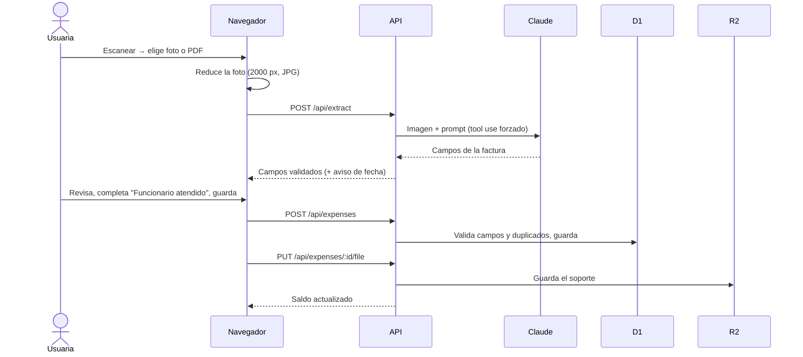
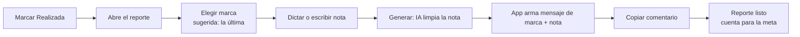
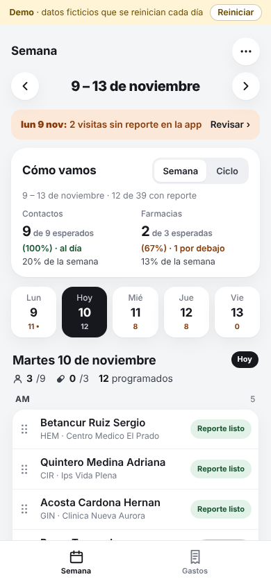
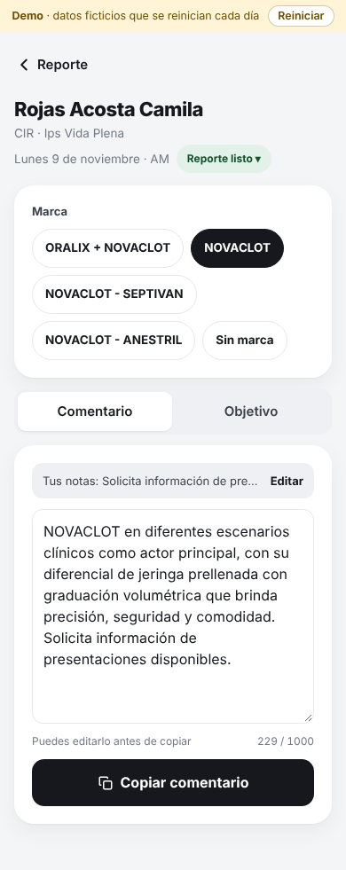
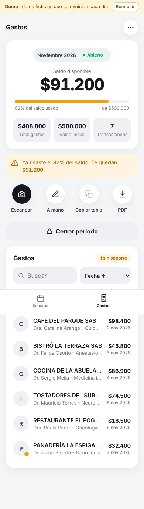
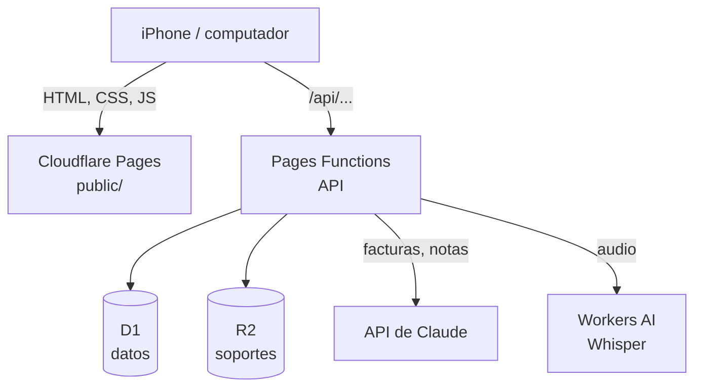
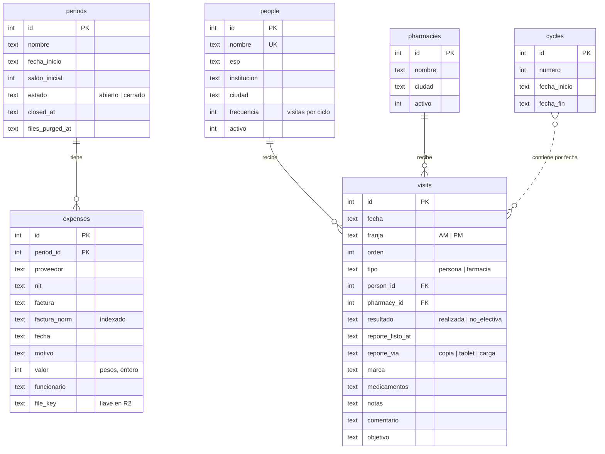

# PRD · Visita médica: asistente para una visitadora médica

| | |
|---|---|
| **Producto** | App web para planear, reportar y legalizar el trabajo diario de una visitadora médica |
| **Dueño de producto** | Juan Carlos Franco Zafra |
| **Desarrollo** | Claude Code (código), a partir de las definiciones de producto |
| **Estado** | En producción desde oct-2026 (fases 0–2). Fase 3 en definición |
| **Última actualización** | 10-nov-2026 |
| **Demo** | https://visita-medica-demo.pages.dev · PIN 1234 (datos ficticios) |

> Esta es la versión pública del documento. El laboratorio, las marcas, las personas y los datos son ficticios; las reglas, las decisiones y los resultados son los reales.

## Contenido
1. [Resumen](#1-resumen)
2. [Problema y contexto](#2-problema-y-contexto)
3. [Usuaria y partes interesadas](#3-usuaria-y-partes-interesadas)
4. [Objetivos y métricas de éxito](#4-objetivos-y-métricas-de-éxito)
5. [Alcance por fases](#5-alcance-por-fases)
6. [Requisitos funcionales](#6-requisitos-funcionales)
7. [Reglas de negocio](#7-reglas-de-negocio)
8. [Decisiones y trade-offs](#8-decisiones-y-trade-offs)
9. [IA en el producto](#9-ia-en-el-producto)
10. [Experiencia de usuario](#10-experiencia-de-usuario)
11. [Requisitos no funcionales](#11-requisitos-no-funcionales)
12. [Stack y lenguajes](#12-stack-y-lenguajes)
13. [Infraestructura y despliegue](#13-infraestructura-y-despliegue)
14. [Seguridad y privacidad](#14-seguridad-y-privacidad)
15. [Modelo de datos](#15-modelo-de-datos)
16. [Riesgos, aprendizajes y próximos pasos](#16-riesgos-aprendizajes-y-próximos-pasos)

---

## 1. Resumen
Una visitadora médica gasta buena parte de su día en trabajo administrativo: escribir el reporte de cada visita, armar la planeación semanal y legalizar los gastos de una tarjeta corporativa. Esta app reúne las tres tareas en el celular, usa IA donde ahorra tiempo (leer facturas, transcribir y limpiar lo que dicta) y deja todo listo para pegar en las herramientas que el laboratorio ya usa (la tablet de reportes y un Excel de legalización).

**Resultado:** los reportes de visitas pasaron de ~2 horas a ~20 minutos al día y la planeación semanal de ~3 horas a ~30 minutos.

## 2. Problema y contexto
### Un día de trabajo
- **Visitas:** la meta es 9 contactos (médicos y personal de salud) y 3 farmacias por día hábil, en un ciclo de 20 días hábiles. Cada médico tiene una frecuencia de visita por ciclo.
- **Reporte:** después de cada visita se escribe en la tablet del laboratorio un *comentario* y un *objetivo*. El comentario empieza con el mensaje aprobado de la marca que se presentó y sigue con lo que pasó en la visita.
- **Planeación:** cada semana se define a quién visitar, qué día, en qué franja (AM/PM) y dónde, cuidando que nadie del panel se quede sin su frecuencia.
- **Gastos:** cafés y almuerzos con médicos se pagan con una tarjeta débito precargada (cupo mensual). Cada mes hay que pasar las facturas a una hoja de Excel de legalización y entregar un PDF con los soportes.

### Dolores
| Dolor | Evidencia |
|---|---|
| Mucho tiempo en reportes | ~2 h diarias escribiendo en la tablet, muchas veces de noche |
| Planeación lenta | ~3 h semanales cruzando el panel con lo ya visitado |
| No sabe cuánto lleva del cupo | Se pasaba del saldo sin darse cuenta |
| Errores al legalizar | Datos mal copiados, descuadres, soportes en desorden |
| No sabe cómo va frente a la meta | Solo lo sabía al cierre del ciclo |

### Restricciones del entorno (no negociables)
- La tablet y el Excel del laboratorio **no se pueden cambiar**: la app tiene que adaptarse a ellos.
- El Excel tiene **celdas combinadas**: pegar una tabla normal descuadra las columnas.
- Los mensajes de marca son **texto aprobado** por el laboratorio: no se pueden reescribir.
- La usuaria trabaja desde el **iPhone**, en la calle y con conectividad variable.

## 3. Usuaria y partes interesadas
**Usuaria principal: la visitadora médica.**
- Usa el iPhone para todo; el computador solo en casa.
- Escanea facturas con una app de escáner y las guarda como PDF.
- Prefiere tocar a escribir y dictar a teclear.
- No es técnica: cualquier fricción (un selector que no abre, un zoom inesperado) la frena.

**Dueño de producto y administrador (Juan).** Define reglas y prioridades, prueba cada cambio en su propio iPhone, mantiene el panel de médicos y farmacias y administra la infraestructura. No usa terminal: los cambios de datos se hacen pegando SQL en la consola de Cloudflare.

**El laboratorio.** Recibe los reportes en la tablet y el Excel de legalización. No interactúa con la app.

## 4. Objetivos y métricas de éxito
### Objetivos
1. Reducir el tiempo administrativo diario de la usuaria.
2. Que siempre sepa cuánto saldo le queda y cómo va frente a la meta.
3. Cero reprocesos al legalizar (sin descuadres ni facturas repetidas).

### No-objetivos
- Reemplazar la tablet o el Excel del laboratorio.
- Servir a más de una usuaria o a un equipo.
- Hacer contabilidad (conciliación bancaria, impuestos).

### Métricas
| Métrica | Antes | Después | Cómo se mide |
|---|---|---|---|
| Tiempo en reportes de visitas | ~2 h/día | **~20 min/día** | Reporte de la usuaria |
| Tiempo de planeación semanal | ~3 h/semana | **~30 min/semana** | Reporte de la usuaria |
| Visitas con reporte listo vs. meta | Desconocido hasta el cierre | Visible a diario | "Cómo vamos" en la app |
| Facturas duplicadas legalizadas | Ocurría | 0 (bloqueo) | Regla en la API |
| Uso | — | Diario desde oct-2026 | Uso observado |

**Medición pendiente:** instrumentar cuántos campos edita la usuaria después de la lectura de una factura con IA (ver [9.5](#95-evaluación-evals)).

## 5. Alcance por fases
| Fase | Contenido | Estado |
|---|---|---|
| **0 · Gastos** | PIN, períodos, escaneo de facturas con IA, saldo y alertas, copiar tabla, PDF de soportes | En producción (oct-2026) |
| **1 · Visitas** | Semana, estados, "Cómo vamos", planear un día, ciclos, carga inicial del panel | En producción (28-oct-2026) |
| **2 · Reporte** | Reporte por visita, dictado, ajuste del texto con IA, mensajes de marca | En producción (2-nov-2026) |
| **3 · Cobertura** | Quién del panel falta por visitar en el ciclo, por ciudad e institución | En definición |

**Fuera de alcance (a propósito):** app nativa, lectura de códigos QR de facturas, comisión de retiro e impuesto 4×1000, conciliación bancaria, varias usuarias, modo sin conexión.

## 6. Requisitos funcionales
### 6.1 Sesión
- **RF-01** Ingreso con PIN de 4 dígitos; la sesión dura 7 días.
  - *Aceptación:* PIN incorrecto muestra error y no da acceso; tras 8 fallos desde una IP en 15 min se bloquea esa IP.
- **RF-02** Cerrar sesión desde el menú.

### 6.2 Visitas
- **RF-10 Semana.** Ver la semana (lunes a viernes) con las visitas de cada día separadas en AM y PM.
  - *Aceptación:* hoy aparece seleccionado; los festivos de Colombia se marcan como no hábiles.
- **RF-11 Estados.** Cada visita tiene un estado que se cambia tocando el chip: *Por hacer*, *Realizada* → *Pendiente reporte* → *Reporte listo*, *No efectiva*, *Lo reporté directo en la tablet*. Si pasa el día sin marcar, queda *No realizada*.
  - *Aceptación:* solo "Reporte listo" cuenta para la meta; las no efectivas no cuentan.
- **RF-12 Aviso de pendientes.** Si hay días anteriores con visitas sin reporte, aparece un aviso con enlace a ese día.
- **RF-13 Cómo vamos.** Para la semana y para el ciclo: contactos y farmacias con reporte, frente a lo esperado a la fecha y frente al total.
  - *Aceptación:* "esperado" = meta diaria × días hábiles **ya terminados** (hasta ayer); verde si va al día, naranja si va por debajo.
- **RF-14 Planear un día.** Elegir ciudad → institución, o buscar por nombre; marcar AM/PM con un toque; agregar todos con un botón.
  - *Aceptación:* sin búsqueda solo aparecen quienes aún tienen visitas pendientes en el ciclo; al buscar aparece todo el panel de la ciudad. Nunca dos visitas a la misma persona o farmacia el mismo día.
- **RF-15 Mover.** Arrastrar para cambiar el orden, la franja y (en computador) el día. Las visitas futuras se quitan con ×.
- **RF-16 Copiar por día.** Copiar contactos (médico · especialidad · dirección, AM y luego PM) y farmacias para el formato de planeación del laboratorio.
- **RF-17 Ciclos.** Crear y editar ciclos (número, inicio, fin).
  - *Aceptación:* los ciclos no se pueden cruzar.

### 6.3 Reporte
- **RF-20** Al marcar *Realizada* o *No efectiva* se abre el reporte de la visita.
- **RF-21 Marca.** Elegir una de las marcas (o "Sin marca"); queda sugerida la de la última visita a esa persona. En farmacias se marcan los medicamentos en inventario.
- **RF-22 Nota.** Dictar (máx. 3 min) o escribir la nota del comentario y, aparte, la del objetivo.
- **RF-23 Generar.** La IA limpia la nota y la app arma *mensaje de marca + nota* para el comentario y *objetivo fijo + nota* para el objetivo.
- **RF-24 Copiar.** Copiar el comentario deja el reporte listo.
  - *Aceptación:* contador de 1.000 caracteres que se pone amarillo al pasarse (no bloquea).
- **RF-25** Todo se guarda solo mientras la usuaria escribe.

### 6.4 Gastos
- **RF-30 Períodos.** Iniciar un período (nombre, fecha de inicio, saldo inicial prellenado en $500.000). Solo uno abierto a la vez.
- **RF-31 Escanear.** Subir foto o PDF; la IA llena proveedor, NIT, número de factura, fecha y valor; la usuaria revisa, completa "Funcionario atendido" y guarda.
  - *Aceptación:* en el celular primero aparece "Elegir archivo" (PDF desde Archivos) y luego "Foto o fototeca".
- **RF-32 A mano.** Registrar un gasto sin archivo.
- **RF-33 Duplicados.** Bloquear una factura con el mismo NIT y número, en cualquier período.
- **RF-34 Saldo.** Mostrar siempre saldo disponible, total, transacciones y % usado.
- **RF-35 Soportes.** Adjuntar o cambiar el soporte de un gasto; la app marca los gastos "sin soporte".
- **RF-36 Copiar tabla.** Copiar las 16 columnas del formato de legalización.
- **RF-37 PDF.** Descargar un solo PDF con todos los soportes en el orden de la tabla.
- **RF-38 Cerrar y reabrir.** Cerrar el período con pantalla de revisión; reabrir si no hay otro abierto.

## 7. Reglas de negocio
| Regla | Por qué |
|---|---|
| El saldo puede quedar negativo; amarillo desde 80%, rojo al 100% | Lo que cuenta es lo que ya salió de la tarjeta; bloquear no evita el gasto |
| La IA toma el **total pagado con propina** | Es lo que se descuenta de la tarjeta |
| Duplicado = mismo **NIT + número de factura** (ignorando espacios, guiones, mayúsculas y dígito de verificación) | El consecutivo es único por comercio, no entre comercios |
| Un gasto puede ser de un mes distinto al del período | Facturas que llegan tarde |
| El soporte es opcional al guardar, con aviso antes de cerrar | No frenar el registro en la calle |
| Copiar tabla: 16 columnas con vacías donde el Excel combina celdas; valor como número plano, fecha AAAA-MM-DD | Que el pegado caiga exacto desde "Item" |
| Los soportes se borran 2 meses después del cierre | Minimizar datos guardados; el laboratorio ya los recibió |
| Meta: 9 contactos y 3 farmacias por día hábil; ciclo de 20 días hábiles sin sábados ni festivos | Así lo mide el laboratorio |
| "Esperado" se calcula hasta ayer; lo hecho incluye las visitas de hoy con reporte listo | Comparar contra un día que no ha terminado la hacía ver atrasada cada mañana |
| Disponibles para planear = frecuencia − realizadas − programadas desde hoy | Que nadie quede sin su frecuencia ni con visitas de más |
| El mensaje de marca **nunca** pasa por la IA | Es texto aprobado por el laboratorio |
| Nota de la usuaria en minúsculas, mayúscula al iniciar cada oración, medicamentos en MAYÚSCULA | Formato que pide el laboratorio en la tablet |
| No efectiva: comentario "Visita no efectiva" + nota; objetivo en blanco | Formato del laboratorio |
| "Hoy" siempre en hora de Bogotá | El servidor corre en UTC |

## 8. Decisiones y trade-offs
| Decisión | Alternativas | Por qué |
|---|---|---|
| **App web**, no nativa | iOS nativa, Lovable | Sin tiendas ni instalación; un link funciona en iPhone y computador; cambios publicados al instante |
| **Cloudflare** (Pages + D1 + R2) | Supabase, Firebase | Plan gratis suficiente y sin pausas por inactividad (Supabase gratis pausa proyectos tras una semana) |
| **Sin framework** de frontend | React, Vue | App pequeña: menos peso en el iPhone, sin compilación, menos dependencias que mantener |
| **PDF en el navegador** (pdf-lib) | Generarlo en el servidor | El plan gratis da ~10 ms de CPU por petición |
| **Limpieza al abrir la app** (1 vez al día) | Tarea programada | Pages no tiene cron |
| **PIN** de 4 dígitos | Usuario y contraseña, login con Google | Una sola usuaria; rapidez en el celular. Compensado con bloqueos (ver [14](#14-seguridad-y-privacidad)) |
| **Avisar** en vez de bloquear (saldo, soporte, 1.000 caracteres) | Bloquear | La realidad manda: el gasto ya ocurrió, la tablet puede aceptar más |
| **Bloquear** solo duplicados | Avisar | Un duplicado legalizado es un error caro y fácil de evitar |
| Totales y estados **calculados**, no guardados | Guardar campos | Nunca quedan desactualizados |
| Mensajes de marca **en código** (`public/marcas.js`) | Tabla en la base | Cambian casi nunca, los usa la app y la API, y quedan versionados |
| Lanzar por **fases** con versión de prueba por rama | Todo de una vez | La usuaria valida cada parte antes de depender de ella |
| `<label for>` para abrir el selector de archivos | `.click()` desde JS | Algunas versiones de Safari en iOS ignoraban el `.click()` (bug real en producción) |

## 9. IA en el producto
### 9.1 Casos de uso
| Caso | Entrada → salida | Por qué IA |
|---|---|---|
| **Leer facturas** | Foto/PDF → proveedor, NIT, número, fecha, total, notas | Cada comercio tiene un formato distinto; una plantilla por comercio no escala |
| **Transcribir dictado** | Audio → texto | Hablar al salir de la visita es más rápido que escribir |
| **Ajustar la nota** | Dictado crudo → texto limpio | Quitar muletillas y corregir sin cambiar el sentido |

**Dónde no se usa IA, a propósito:** mensajes de marca, metas, saldo, duplicados, fechas hábiles y formato final del texto. Son cálculos exactos o texto aprobado.

### 9.2 Modelos
| Uso | Modelo | Por qué |
|---|---|---|
| Facturas y ajuste de texto | **Claude Haiku 5.5** (API de Anthropic) | Lee imágenes y PDF, buen español, rápido y barato. Configurable con `CLAUDE_MODEL` sin tocar código |
| Dictado | **Whisper large-v3-turbo** (Cloudflare Workers AI) | Español, incluido en Cloudflare, con pista de vocabulario |

Costo estimado: **USD 1–2 al mes** para el uso de una persona.

### 9.3 Diseño de prompts y salidas
**Facturas** (`lib/extract.js`)
- **Tool use forzado:** el modelo tiene que llamar una herramienta `registrar_factura` con un esquema fijo (proveedor, NIT, factura, fecha impresa, fecha, valor, notas). No hay texto libre que interpretar.
- Reglas en el prompt: proveedor en MAYÚSCULAS; NIT sin dígito de verificación; número con prefijo y sin espacios; fechas colombianas en día/mes/año, con la fecha de hoy como referencia; total pagado con propina; **si un dato no se lee con seguridad, se deja vacío y se explica en notas** en lugar de inventarlo.
- Se pide la fecha **tal cual está impresa** además de la interpretada, para poder corregirla en código.

**Ajuste de la nota** (`lib/redactar.js`)
- Instrucciones: corregir ortografía y puntuación, quitar muletillas, conservar el sentido, **no agregar información, no inventar, no opinar**, tercera persona, responder solo el texto.
- La nota va pegada después del mensaje de marca, por eso se le pide no repetirlo ni resumirlo.

**Dictado**
- Audio WAV 16 kHz mono (máx. 3 min), idioma español fijo, filtro de silencios y los nombres de los medicamentos como pista para que los transcriba bien.

### 9.4 Guardrails
| Guardrail | Cómo |
|---|---|
| **Humano en el ciclo** | Nada se guarda ni se copia sin que la usuaria lo vea y lo pueda editar |
| **Validación en código después de la IA** | NIT solo dígitos; valor entero; número sin espacios; formato final del texto aplicado por código (no por el modelo) |
| **Corrección de fechas** | Si la fecha leída queda lejos de hoy y al invertir día/mes queda cerca, se corrige y se avisa "Revisa la fecha" |
| **Texto aprobado aislado** | El mensaje de marca nunca entra al prompt; solo se procesa la nota de la usuaria |
| **Degradación elegante** | Si la IA falla, el formulario queda para llenar a mano; el error muestra el motivo |
| **Límites de entrada** | Archivos de máx. 15 MB (3 MB en la demo), notas de máx. 3.000 caracteres, audio de máx. 3 min |
| **Control de duplicados** | Aunque la IA lea bien, la API bloquea facturas repetidas |
| **Secretos** | La llave de la API solo vive en el servidor |
| **Demo pública** | IA simulada: sin costo ni riesgo de abuso de la llave |

### 9.5 Evaluación (evals)
**Lo que existe hoy**
- Pruebas automáticas de todo lo determinístico alrededor de la IA: normalización del texto, armado del reporte, corrección de fechas, duplicados.
- Validación cualitativa con la usuaria: revisa cada resultado antes de guardarlo y reporta lo que sale mal. Así se detectaron, por ejemplo, fechas con día y mes invertidos (y se agregó la corrección) y la preferencia por mayúscula al iniciar cada oración.

**Plan de evals (propuesto)**
| Eval | Set | Métrica | Umbral |
|---|---|---|---|
| Lectura de facturas | 30–50 facturas reales anonimizadas (fotos, PDF, tiquetes POS) con su respuesta correcta | Exactitud por campo (NIT, número, fecha, valor) y % de facturas sin ninguna edición | ≥ 95% en NIT y valor |
| Fechas | Subconjunto con fechas ambiguas (03/11 vs 11/03) | % correctas tras la corrección en código | 100% |
| Ajuste de nota | 30 dictados reales con muletillas | No inventa datos (revisión), conserva el sentido, quita muletillas | 0 datos inventados |
| Costo | Mismo set | USD por factura y latencia | Comparar al cambiar de modelo |

Se correría al cambiar de modelo o de prompt para comparar calidad contra costo.

**Métrica en producción (propuesta):** guardar qué campos cambió la usuaria después de la lectura con IA. Es la señal más directa de calidad sin esfuerzo adicional para ella.

### 9.6 Costos y monitoreo
- Errores de la API se registran en los logs de Cloudflare (estado y motivo, nunca la llave).
- El modelo se cambia por variable de entorno, lo que permite probar uno nuevo en la versión de prueba antes de producción.

## 10. Experiencia de usuario
### Principios
- **iPhone primero**, con versión de computador lado a lado.
- **Un toque por acción** (estados, AM/PM, agregar).
- **Avisar, no regañar:** colores (amarillo/rojo/naranja) y mensajes cortos.
- **Encajar en lo existente:** lo que sale de la app se pega tal cual en la tablet o el Excel.
- Referencia visual: apps financieras tipo Revolut; tema claro, números grandes y legibles.

### Flujo: escanear una factura

### Flujo: reportar una visita

### Capturas
| Semana | Reporte | Gastos |
|---|---|---|
|  |  |  |

## 11. Requisitos no funcionales
| Requisito | Objetivo |
|---|---|
| **Costo** | Plan gratis de Cloudflare + USD 1–2/mes de IA |
| **Rendimiento** | Pantallas sin recargar; fotos reducidas en el celular (~4 MB → ~300 KB) antes de subirlas |
| **Disponibilidad** | La de Cloudflare; requiere conexión (no hay modo sin conexión) |
| **Compatibilidad** | Safari en iOS (incluye fotos HEIC) y navegadores de escritorio |
| **Localización** | Español (Colombia); pesos colombianos; fechas y festivos de Colombia; hora de Bogotá |
| **Mantenibilidad** | Sin dependencias en el frontend; pruebas automáticas en cada cambio |

## 12. Stack y lenguajes
| Capa | Tecnología | Lenguaje |
|---|---|---|
| Frontend | HTML, CSS y JavaScript sin framework (módulos ES), rutas por hash | JavaScript, HTML, CSS |
| Backend | Cloudflare Pages Functions (runtime de Workers) | JavaScript |
| Base de datos | Cloudflare D1 | SQL (SQLite) |
| Archivos | Cloudflare R2 | — |
| IA | API de Claude; Whisper en Workers AI | — |
| PDF | pdf-lib (en el navegador) | JavaScript |
| Herramientas | wrangler (desarrollo local y despliegue) | — |
| Pruebas | Node.js con `node:assert` contra el servidor local | JavaScript |

**Dependencias:** solo dos (`wrangler` y `pdf-lib`), ambas de desarrollo. Agregar una nueva requiere acordarlo.

**Pruebas:** 106 pruebas automáticas (89 de la app y 17 del modo demo) que cubren sesión, bloqueos, períodos, gastos, duplicados, visitas, estados, metas, reporte, fechas y festivos.

## 13. Infraestructura y despliegue
### Componentes

### Entornos
| Entorno | Cuándo | Datos |
|---|---|---|
| **Producción** | Push a `main` | Base y bucket reales |
| **Preview** | Cualquier otra rama (`<rama>.<proyecto>.pages.dev`) | Base y bucket de prueba propios |
| **Demo pública** | Repo aparte, `DEMO_MODE = "1"` | Datos ficticios que se reinician cada día; IA simulada |
| **Local** | `npm run dev` | Base local vacía |

### Despliegue
1. Rama nueva → Cloudflare publica una versión de prueba con su propia base.
2. El dueño de producto y la usuaria la prueban.
3. Pull request a `main` → producción se publica sola.
4. Cambios de datos (panel, ciclos): SQL pegado en la consola de D1.

### Límites del plan gratis que moldearon el diseño
| Límite | Consecuencia |
|---|---|
| ~10 ms de CPU por petición | PDF en el navegador; archivos enviados ya en base64 |
| Sin tareas programadas en Pages | Limpieza de soportes y reinicio de la demo al primer ingreso del día |
| 100.000 peticiones/día, 5 GB en D1, 10 GB en R2 | Holgura de varios órdenes de magnitud para una usuaria |

## 14. Seguridad y privacidad
### Acceso
- PIN guardado como **secreto** del servidor; comparación en **tiempo constante**.
- Sesión con token aleatorio en cookie **`HttpOnly`, `Secure`, `SameSite=Lax`**, válida 7 días; cerrar sesión la borra del servidor.
- **Fuerza bruta:** 8 fallos por IP en 15 min bloquean esa IP; además, un límite global (20 fallos en una hora o 50 en un día, sumando todas las IP) bloquea el ingreso con PIN para frenar a quien rote IPs. Las sesiones abiertas siguen funcionando. Con 50 intentos al día, recorrer la mitad de los PIN tomaría más de 3 meses.

### Datos y secretos
- La llave de la API de Claude **solo vive en el servidor**; el navegador nunca la ve.
- **Validación en el servidor** de todo lo que llega (el navegador valida solo por comodidad).
- Los archivos están en un **bucket privado** y se sirven solo con sesión; formato (JPG, PNG, PDF) y tamaño limitados.
- **Minimización:** los soportes se borran 2 meses después del cierre del período.
- Los CSV con el panel real (nombres de médicos) **nunca van a git**; solo los `*.ejemplo.csv`.
- Cabeceras `X-Content-Type-Options: nosniff`, `X-Frame-Options: DENY`, `Referrer-Policy`; la app pide no ser indexada.

### Privacidad hacia proveedores de IA
- A Claude se envían la imagen de la factura y la nota de la usuaria; a Workers AI, el audio. No se envían nombres del panel ni datos de sesión.

### Demo pública
- Repo separado sin historial del privado; datos 100% ficticios, verificados contra el panel real para que ningún nombre coincida.
- PIN público, por eso no aplica el bloqueo global; archivos de máx. 3 MB que se borran cada día.

### Riesgos aceptados
- Un solo factor (PIN) y sin recuperación de PIN (lo restablece el administrador).
- Una sola usuaria: no hay roles ni permisos.

## 15. Modelo de datos

Tablas de soporte: `sessions` (token, vence), `login_fails` (ip, fecha) y `meta` (fecha de la última limpieza o reinicio).

### Reglas que hace cumplir la base
- Un solo período abierto (índice único parcial).
- Nunca dos visitas a la misma persona o farmacia el mismo día (índices únicos).
- Una visita es de persona **o** de farmacia, nunca de ambas (CHECK).

### Lo que se calcula en vez de guardarse
| Dato | Cómo |
|---|---|
| Total, saldo disponible, transacciones | `SUM` / `COUNT` de los gastos del período |
| Estado de una visita | Resultado + fecha + `reporte_listo_at` (por hacer, programada, no realizada, pendiente, listo…) |
| Ciclo de una visita | El ciclo que contiene su fecha (sin llave), así una semana puede quedar entre dos ciclos |
| "Item" del Excel | Posición al ordenar por fecha |
| Disponibles para planear | Frecuencia − realizadas − programadas desde hoy |

### Convenciones
- Valores en pesos como **enteros**; fechas como texto **AAAA-MM-DD** (ordenan bien y salen así al Excel).
- El esquema se crea solo en la primera petición; las columnas nuevas se agregan con una lista de migraciones.
- Panel y farmacias no se borran: se marcan inactivos para no perder el historial.

## 16. Riesgos, aprendizajes y próximos pasos
### Riesgos
| Riesgo | Mitigación |
|---|---|
| Dependencia de una sola usuaria y un solo administrador | Documentación del contexto y la arquitectura en el repo |
| El laboratorio cambia la tablet o el Excel | Formatos de copiado aislados en funciones pequeñas y fáciles de ajustar |
| La IA lee mal una factura | Revisión humana obligatoria, validaciones en código, duplicados bloqueados |
| Cambios en los modelos o la API (p. ej. un parámetro que deja de aceptarse) | Modelo configurable; errores con motivo visible; probar primero en preview |
| Costo de IA en la demo pública | IA simulada |

### Aprendizajes
- **Probar en el dispositivo real de la usuaria.** "Adjuntar" funcionaba en un iPhone y no en otro: Safari ignoraba la apertura del selector desde JavaScript. Se cambió por un mecanismo nativo del HTML.
- **Las métricas tienen que ser justas para motivar.** Comparar lo hecho contra lo esperado *hasta hoy* la hacía ver atrasada cada mañana; se cambió a *hasta ayer*.
- **La IA rinde más cuando el formato lo pone el código.** La IA limpia; las mayúsculas, los medicamentos y la unión con el mensaje aprobado los hace el código, de forma predecible.
- **Encajar en lo existente vale más que rediseñarlo.** Copiar con columnas vacías para las celdas combinadas evitó pedirle cambios al laboratorio.

### Próximos pasos
1. **Fase 3 · Cobertura:** quién del panel falta por visitar en el ciclo, por ciudad e institución.
2. **Evals de lectura de facturas** con un set real anonimizado (ver [9.5](#95-evaluación-evals)).
3. **Métrica de ediciones** después de la IA, en producción.
